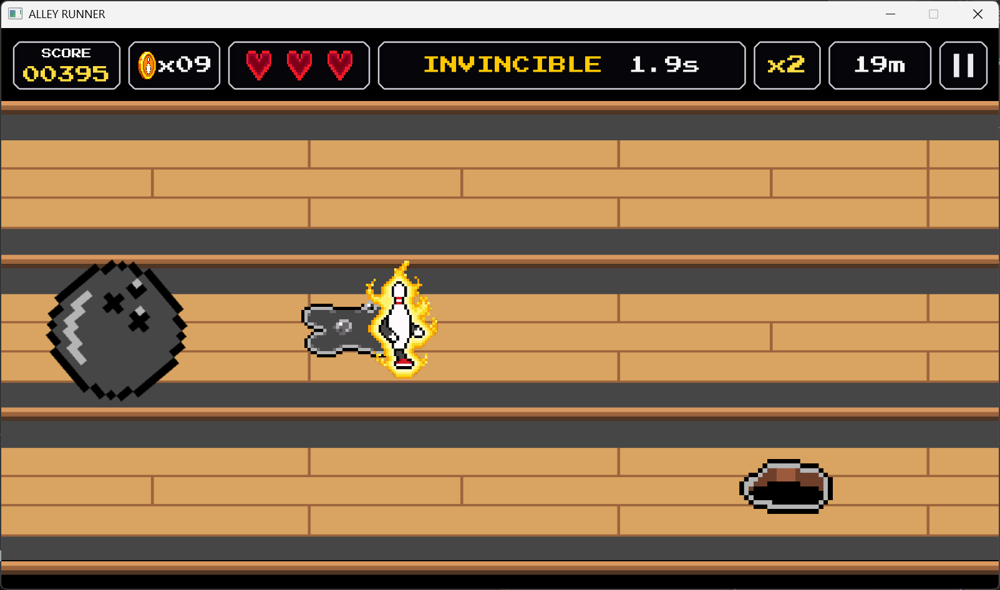

# Alley Runner [By IsaacACat]

A three-lane endless runner where a bowling pin flees a giant bowling ball. Dodge obstacles, collect coins, and take risks to build your score multiplier while protecting your lead.

## Concept & Problem Space

- **Situation:** Endless runners are easy to pick up and suit quick gaming breaks.
- **Complication:** Predictable patterns and static speeds can make a run feel repetitive.
- **Design question:** How can we keep a runner tense and reward risky play without overwhelming the controls?
- **Our answer:** Combine three-lane movement, escalating speed, a pursuing bowling ball, risky collectibles, and occasional visual distractions.

## Gameplay

1. Control the bowling pin and switch between three lanes using **W / S**.
2. Avoid barriers, oil spills, and holes while the environment moves toward you.
3. Collect coins and multiplier stars to increase your score.
4. Use shields, temporary invulnerability, and heart pickups to survive longer.
5. Keep your distance from the chasing bowling ball and aim for a new high score.

### Intended Rules

| System | Intended behavior |
| --- | --- |
| Hearts | Start with 3 hearts; maximum 3. Ordinary barrier collisions remove 1 heart. |
| Holes | Cause immediate death; Unkillable does not protect against them. |
| Oil spills | Force a random lane change; slowing/chase-distance effects require final balancing. |
| Ragebait words | Brief, randomly timed text bursts overlay gameplay and distract the player. They have no collision damage. |
| Shield | Blocks 1 barrier collision and expires after 10 seconds if unused. |
| Unkillable | Protects against barriers for 5 seconds, but not holes. |
| Extra Life | Restores 1 heart when below 3; does nothing at full health. |
| Multiplier stars | Increase the score multiplier; proposed progression: 2x → 4x → 6x. |
| Pursuer | The bowling ball closes in as the player loses their safety margin. |
| Game over | Triggered by 0 hearts, a hole, or the pursuer catching the pin. |

## Task Tracker

### Gwen

- [x] **UI / Menus — Main Menu:** Implement and test Play, How to Play, Options, and Exit, including menu music, click sounds, and Music/SFX sliders.
- [x] **Collision + Health — Barrier Collision:** Apply 1-heart damage on an ordinary barrier hit; respect active Shield and Unkillable effects.
- [x ] **Obstacles — Barrier:** Add the barrier obstacle asset, spawning, rendering, and a hitbox aligned with its visible shape.
- [x] **Obstacles — Oil Spill:** Add the oil-spill obstacle, visual feedback, and contact detection; integrate with Isaac's random-lane behavior.
- [x] **Obstacles — Hole in Ground:** Add the hole obstacle asset, spawning, rendering, and detection hook for Isaac's death behavior.
- [x] **Distractions — Ragebait Words:** Show large moving text in unpredictable, brief bursts with quiet periods; keep it independent of physical obstacles and hide it during death/menu screens.

### Isaac

- [x] **Player Movement — Lane Switching:** Switch the player between 3 lanes using W/S without leaving the lane bounds.
- [x] **Player Movement — Oil Spill → Random Lane:** Force a random lane change when an oil spill is triggered; coordinate with Gwen's hazard implementation.
- [x] **Difficulty — Increasing Obstacle Speed:** Increase obstacle speed over time up to a maximum; keep spacing playable at higher speeds.
- [x] **Death System — Hole Collision:** Trigger immediate death on falling into a hole, including while Unkillable is active.
- [x] **Death System — Falling Into Hole Animation:** Trigger and complete the falling animation before the death screen.
- [x] **Collectibles — Coins:** Spawn coins, detect collection, remove collected coins, and update the run's coin count.
- [x] **Scoring — Score Multiplier:** Update the multiplier when stars are collected and apply it to score calculation.
- [x] **Scoring — Run Score:** Increase score while running using elapsed time; stop score accumulation on death.

### Xiao Hui

- [x] **Animation — Bowling Ball Running/Rolling:** Create and integrate the pursuing ball's movement animation.
- [x] **Animation — Pin Running:** Create and integrate the player pin's running animation.
- [ ] **Collectibles / Animation — Floating Coin:** Create the coin's floating or bobbing animation.
- [ ] **Collectibles — Score Multiplier Star:** Create the star's visual/animation and collection hook; integrate with Isaac's multiplier logic.
- [ ] **Power-Up Animation — Shield:** Show the shield effect while active; remove it on use or expiry.
- [ ] **Power-Up Animation — Unkillable:** Show the effect for the active 5-second period and remove it on expiry.

### Lekkar

- [x] **Collision + Health — Heart System:** Start with 3 hearts, cap health at 3, and expose damage/healing updates.
- [x] **Death System — Death at 0 Hearts:** Trigger death exactly once when health reaches 0.
- [x] **UI / Menus — Death Screen:** Show final score and coins; support Restart and return to the main menu.
- [x] **UI / Menus — Pause Menu:** Pause gameplay updates and provide Continue and return-to-menu actions.
- [x] **UI / Menus — Health Display:** Render 3 heart indicators and update them when health changes.

### Shared Responsibilities — Xiao Hui & Isaac

- [x] **Animation / Death System — Pin Death:** Xiao Hui creates/prepares the pin death animation; Isaac integrates its trigger and playback into the death flow.

### Unassigned — Ownership Needed

- [x] **Power-Ups — Shield:** Implement the pickup and state; block 1 barrier hit, expire after 10 seconds, and synchronize the visual effect.
- [x] **Power-Ups — Unkillable:** Implement the pickup and 5-second effect; ignore barrier damage but not hole death; synchronize the visual effect.
- [x] **Power-Ups — Extra Life:** Restore 1 heart only when current health is below 3; connect to the health display.
- [x] **Power-Ups — Coin Magnet (Optional):** Attract nearby coins while active; duration and attraction range remain to be decided.
- [x] **Core Systems — Ball Chase / Proximity:** Assign ownership for the ball-to-pin distance, penalties, recovery rules, and catch-triggered game over.

## Technical Systems

| System | Planned implementation |
| --- | --- |
| Movement and scrolling | Delta-time position updates with a capped difficulty/speed curve. |
| Hazard spawning | Random lane selection and speed-adaptive spacing that leaves achievable routes. |
| Collision | AABB and/or circle checks chosen per hazard, with consistent visible hitboxes. |
| Chase distance | A distance/safety-margin value linking setbacks to the ball's approach. |
| Animation | Sprite-sheet frame timing for running, rolling, grabs/death, hazards, and buffs. |
| Ragebait overlay | Separate text pool with random quiet periods and short distraction events; no damage checks. |
| Audio | Separate Music and SFX groups controlled through Options. |
| State flow | Main Menu → Gameplay ↔ Pause → Death Screen → Restart / Main Menu. |
| Cleanup | Release image and sound resources using the signatures in the installed CProcessing headers. |

## Scope

### Essential Core

- Three-lane movement and increasing obstacle speed.
- Barriers, oil spills, and fatal holes.
- Bowling-ball chase and game-over behavior.
- Coins, run score, and multiplier stars.
- Hearts, Shield, Unkillable, and Extra Life.
- Main Menu, Pause Menu, and Death Screen.
- Character animation and ragebait distraction overlay.

### Optional / Stretch

- Coin magnet.
- Fullscreen, windowed, and borderless display controls, subject to library support.

### Out of Scope

- Cosmetic shop and coin-spending shop.
- Character customization or selectable pin appearances.

## Delivery Roadmap

| Week | Milestone | Deliverables |
| --- | --- | --- |
| 8 | Acceleration & Scoring | Capped speed scaling, run score, and multiplier-star collection. |
| 9 | Power-Ups & Hazards | Shield, Unkillable, heart restoration, and fatal-hole behavior. |
| 10 | UI & Menu Flow | Main Menu, Pause Menu, Options, and Death Screen with final totals. |
| 11 | Animation Integration | Ball/pin movement, death/fall animations, oil feedback, and buff effects. |
| 12 | Full Playtesting | Test speed curves, collectible rates, hitboxes, distraction frequency, and fairness. |
| 13 | Bug Fixes & Submission | Fix integration/resource issues, verify assets and paths, and prepare the final build. |

## Integration & Playtest Checklist

- [ ] Clean build succeeds with no unresolved symbols.
- [ ] Images, fonts, and sounds load from the configured working directory.
- [ ] All three lanes are reachable, with no out-of-bounds lane selection.
- [ ] Barrier damage, health display, and death triggers agree.
- [ ] Shield blocks exactly 1 barrier collision and expires correctly.
- [ ] Unkillable expires after 5 seconds and never protects against holes.
- [ ] Extra Life never raises health above 3.
- [ ] Multiplier and coin totals reset correctly on restart.
- [ ] Pause freezes gameplay timers and movement as intended.
- [ ] Ragebait events have quiet gaps, cause no damage, and do not cover menus.
- [ ] Returning to the menu and restarting do not duplicate audio playback.
- [ ] Exiting from each state releases resources without image-leak warnings.

## Team

- **Gwen:** Main menu, hazards, barrier collision, and ragebait overlay.
- **Isaac:** Lane movement, difficulty, hole behavior, collectibles/scoring, and shared death integration.
- **Xiao Hui:** Character, collectible, and power-up animation; multiplier-star visuals.
- **Lekkar:** Hearts, health display, pause flow, and death-screen UI.

See the task tracker for individual deliverables and unassigned work.